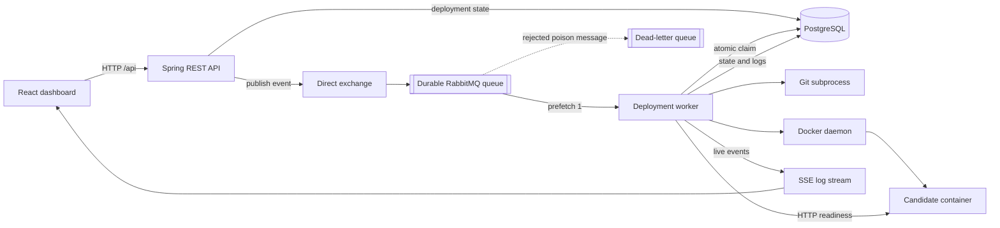

# microPass

microPass is a learning-first, self-hosted deployment platform for one trusted
machine. A user registers a Git repository, requests a deployment, watches live
logs, and receives a health-checked Docker container on an allocated host port.

The project is intentionally smaller than Kubernetes and more structured than a
shell script. Its purpose is both practical and educational: build a useful
single-node PaaS while learning how APIs, durable queues, databases, operating-
system processes, containers, real-time browser streams, tests, and CI fit
together.

## Current v0.1 scope

- React dashboard for application registration and lifecycle actions
- Spring Boot 3.3 / Java 21 REST API and deployment worker
- RabbitMQ durable queue, prefetch one, dead-letter queue, and ACK after processing
- Atomic `QUEUED → CLONING` claim to make redelivery safe
- PostgreSQL schema managed by Flyway, with H2 retained for lightweight local work
- Git synchronization with incremental cache, timeout, cancellation, and process-tree cleanup
- Docker builds and resource-limited candidate containers
- HTTP readiness checks before replacing the previous healthy container
- Live logs over Server-Sent Events with bounded replay and terminal events
- Unit tests, PostgreSQL Testcontainers integration testing, and GitHub Actions CI

## Architecture in one picture



The API returns `202 Accepted` after it stores and publishes a deployment
request. The RabbitMQ listener runs the pipeline inside the listener call, so
the broker acknowledges the message only after handling returns. Because a
message can still be delivered more than once, the worker atomically changes
the database state from `QUEUED` to `CLONING`; only one delivery can claim it.

During replacement, microPass starts a uniquely named candidate container and
accepts only an HTTP 2xx or 3xx readiness response. The previous container stays
alive if the candidate fails. Promotion updates the active container and port,
then removes the previous container.

See [Architecture](docs/ARCHITECTURE.md) for the complete flow, state machine,
failure boundaries, and one-week learning route.

## Prerequisites

- Linux, macOS, or WSL2
- Java 21
- Maven 3.8+
- Docker Engine with permission to use the Docker socket
- Git
- Node.js 20.19+ (or 22.12+) and npm for frontend development or combined packaging

Check them with:

```bash
java -version
mvn -version
docker version
git --version
node --version
npm --version
```

## Production-like local start

Start PostgreSQL and RabbitMQ:

```bash
docker compose up -d postgres rabbitmq
docker compose ps
```

Build the React application, run all tests, and package one Spring Boot JAR:

```bash
./scripts/build-all.sh
```

The full build requires Docker because the integration test starts PostgreSQL
with Testcontainers. To package without tests:

```bash
./scripts/build-all.sh -DskipTests
```

Run the packaged application with PostgreSQL and Flyway:

```bash
SPRING_PROFILES_ACTIVE=postgres \
java -jar backend/target/micropass-0.0.1-SNAPSHOT.jar
```

Open:

- React product UI: `http://localhost:9090/`
- Legacy Thymeleaf prototype: `http://localhost:9090/ui`
- RabbitMQ management UI: `http://localhost:15672`
  - username: `micropass`
  - password: `micropass`

The legacy UI remains for comparison and historical learning. New product work
belongs in the React client.

## Development mode

Terminal 1 — infrastructure:

```bash
docker compose up -d postgres rabbitmq
```

Terminal 2 — backend:

```bash
SPRING_PROFILES_ACTIVE=postgres mvn -pl backend spring-boot:run
```

Terminal 3 — React with a Vite proxy to port 9090:

```bash
cd frontend
npm ci
npm run dev
```

Open `http://localhost:5173`. The frontend calls relative `/api` URLs, so the
same code works through the Vite development proxy and from the packaged JAR.
Set `VITE_API_BASE` only when deliberately hosting the API elsewhere.

### Lightweight H2 mode

Running without the `postgres` profile uses a local H2 file and Hibernate
`ddl-auto=update`:

```bash
mvn -pl backend spring-boot:run
```

RabbitMQ is still required. H2 is convenient for local exploration; PostgreSQL
plus Flyway is the production-like and integration-tested persistence path.

## Deploy the included sample

The fixture is its own Git repository. In the React UI register:

- Name: `sample-app`
- Git URL or local path: the absolute path to `fixtures/sample-app`
- Branch: `main`
- Dockerfile: `Dockerfile`
- Internal port: `80`

Click **Deploy**, open the log console, and follow these states:

```text
QUEUED → CLONING → BUILDING → DEPLOYING → HEALTHY
```

The application card will show the allocated host port in the configured range
`9100–9200`.

## REST API

| Method | Endpoint | Purpose |
|---|---|---|
| `POST` | `/api/apps` | Register an application |
| `GET` | `/api/apps` | List applications |
| `GET` | `/api/apps/{id}/status` | Inspect actual container runtime status |
| `GET` | `/api/apps/{id}/latest-deployment` | Read the latest attempt |
| `GET` | `/api/apps/{id}/deployments` | Read deployment history |
| `POST` | `/api/apps/{id}/deploy` | Queue a deployment; returns `202` |
| `POST` | `/api/apps/{id}/stop` | Stop the active container |
| `DELETE` | `/api/apps/{id}` | Delete app records and workspace |
| `GET` | `/api/deployments/{id}` | Read one deployment |
| `POST` | `/api/deployments/{id}/cancel` | Cancel active deployment work |
| `GET` | `/api/deployments/{id}/logs/stream` | Stream logs as SSE |
| `GET` | `/api/git/branches?gitUrl=...` | List remote Git branches |

Validation errors use structured JSON with `status`, `message`, and optional
`fieldErrors`. A second active deployment or a stop/delete during active work
returns `409 Conflict`. Queue publication failure returns `503 Service
Unavailable` and marks the deployment failed.

## Important configuration

| Property | Default | Meaning |
|---|---|---|
| `server.port` | `9090` | microPass HTTP port |
| `micropass.workspace.base-dir` | `${user.home}/.micropass/workspaces` | Git cache and build workspace |
| `micropass.ports.start` | `9100` | First candidate host port |
| `micropass.ports.end` | `9200` | Last candidate host port |
| `micropass.container.memory` | `512m` | Container memory limit |
| `micropass.container.cpus` | `1.0` | Container CPU limit |
| `micropass.container.pids-limit` | `256` | Container process limit |
| `MICROPASS_DATABASE_URL` | `jdbc:postgresql://localhost:5432/micropass` | PostgreSQL JDBC URL |
| `MICROPASS_DATABASE_USERNAME` | `micropass` | PostgreSQL user |
| `MICROPASS_DATABASE_PASSWORD` | `micropass` | PostgreSQL password |

RabbitMQ connection values use standard Spring properties such as
`spring.rabbitmq.host`, `spring.rabbitmq.username`, and
`spring.rabbitmq.password`.

## Verification

Backend unit and integration tests:

```bash
mvn -pl backend test
```

The PostgreSQL integration test requires a usable Docker daemon. Focused tests
that do not start Testcontainers can be run with:

```bash
mvn -pl backend \
  -Dtest=CommandExecutorTest,HealthCheckServiceTest,DeploymentPipelineServiceTest,DockerServiceTest,AppControllerTest \
  test
```

Frontend type-check and production build:

```bash
cd frontend
npm ci
npm run build
```

## Learn the project

- [One-week learning route](docs/learning/ONE_WEEK_ENGINEERING_ROUTE.md) — daily
  code-reading, testing, and speaking exercises
- [Interview rehearsal guide](docs/INTERVIEW_REHEARSAL.md) — short project
  explanations, questions with answers, follow-ups, and presentation tips
- [Five-minute demo script](docs/DEMO_SCRIPT.md) — repeatable product and failure demo
- [Implementation and learning plan](docs/IMPLEMENTATION_AND_LEARNING_PLAN.md) —
  phases, commit boundaries, completion notes, and verification log

## Honest limitations and security boundary

microPass v0.1 is a trusted, single-node learning platform—not a public
multi-tenant service.

- No authentication, authorization, tenant isolation, TLS, domains, or secret store
- Repository code and Dockerfiles must be trusted; Docker daemon access is effectively host-level control
- No reverse proxy, so successful replacements may receive a different host port; this is safe replacement, not a stable-URL zero-downtime deployment
- One worker consumes one deployment at a time; locks and SSE buffers are in one JVM
- Database creation and RabbitMQ publication form a dual write; a transactional outbox is a future reliability improvement
- Port probing cannot reserve a socket atomically through the later `docker run`; the single worker greatly reduces but does not mathematically eliminate that race
- Build logs are stored in the database and a bounded in-memory replay buffer, not an external log system
- Startup recovery marks interrupted deployments cancelled; it does not yet reconcile every possible Docker/database disagreement
- Generated PHP and Node Dockerfiles are convenience templates, not production buildpacks

These limits are deliberate. The next major engineering step should be chosen
from an observed constraint, not added only to collect technologies.

## Repository map

```text
microPass/
├── backend/                  Spring Boot API, worker, persistence, tests
├── frontend/                 React, TypeScript, Vite, Tailwind dashboard
├── docs/
│   ├── decisions/            Architecture Decision Records
│   ├── learning/             One-week study material
│   ├── phases/               Historical implementation records
│   └── troubleshooting/      Focused operational investigations
├── fixtures/sample-app/      Small Git repository for deployment demos
├── scripts/build-all.sh      React + Spring Boot combined packaging
├── docker-compose.yml        PostgreSQL and RabbitMQ dependencies
└── .github/workflows/ci.yml  Automated backend/frontend verification
```
