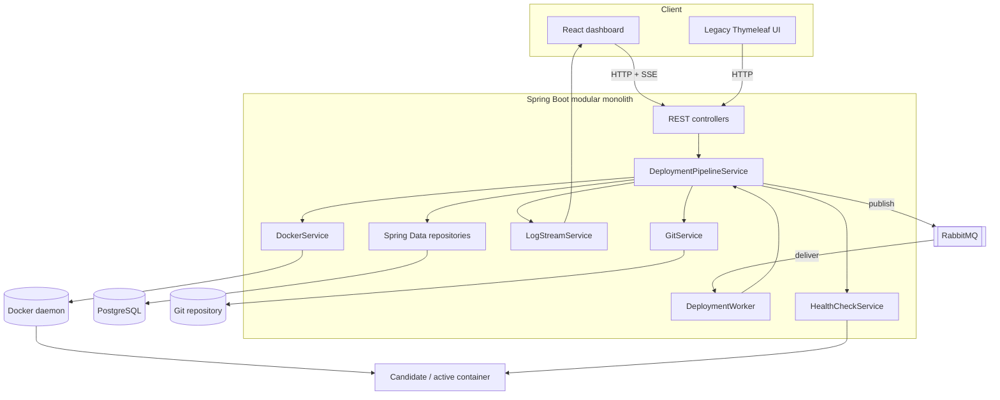
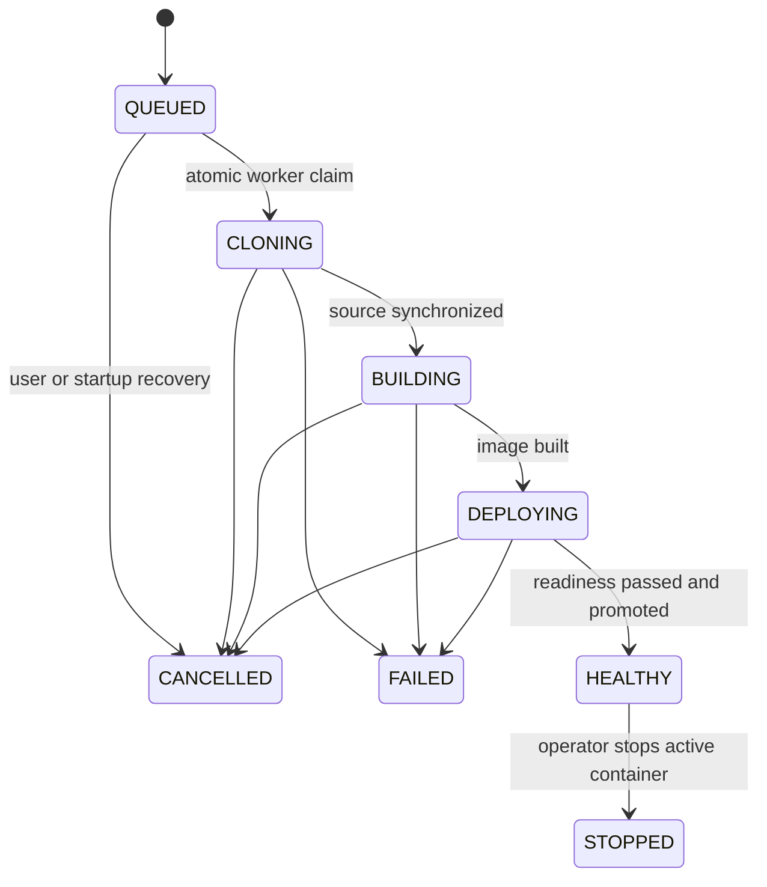
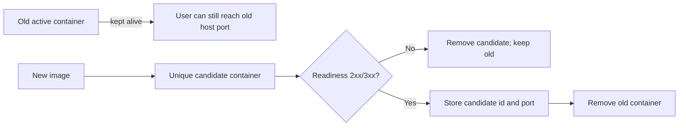

# microPass v0.1 Architecture

## Purpose and boundary

microPass is a control plane for deploying trusted Git repositories as Docker
containers on one machine. A control plane decides and records what should run;
Docker is the execution plane that performs the actual build and runs the
processes.

The v0.1 boundary is intentionally narrow:

- one Spring Boot instance;
- one RabbitMQ deployment consumer with prefetch one;
- one PostgreSQL database;
- one Docker daemon;
- trusted operator and trusted repositories;
- direct host-port access, with optional Caddy routing for stable local URLs.

This boundary makes the system small enough to understand while still exposing
real distributed-systems problems: durable hand-off, duplicate delivery, dual
writes, external side effects, cancellation, state reconciliation, and partial
failure.

## Component map



| Component | Responsibility | It deliberately does not own |
|---|---|---|
| React | Gather intent and present API/runtime state | Deployment truth or Docker operations |
| `AppController` | HTTP translation, validation, response codes | Long-running pipeline execution |
| PostgreSQL | Durable application and deployment state | Git, Docker, or RabbitMQ atomicity |
| RabbitMQ | Buffer and deliver deployment events | Business idempotency or final deployment state |
| `DeploymentWorker` | Consume a queued event inside the listener call | Pipeline rules |
| `DeploymentPipelineService` | Coordinate state, cancellation, Git, Docker, health, and promotion | Low-level command parsing |
| `CommandExecutor` | Run a process, drain output, enforce timeout/cancellation, kill descendants | Business meaning of an exit code |
| Docker | Build images and run constrained containers | Desired-state database records |
| SSE service | Live one-way log delivery and bounded replay | Durable long-term log storage |

## Deployment sequence

```mermaid
sequenceDiagram
    autonumber
    actor User
    participant UI as React
    participant API as Spring API
    participant DB as PostgreSQL
    participant MQ as RabbitMQ
    participant Worker
    participant Git
    participant Docker
    participant Candidate

    User->>UI: Click Deploy
    UI->>API: POST /api/apps/{id}/deploy
    API->>DB: Insert deployment as QUEUED
    API->>MQ: Publish deployment event
    API-->>UI: 202 Accepted + deployment id
    UI->>API: Open SSE log stream
    MQ->>Worker: Deliver event (unacknowledged)
    Worker->>DB: UPDATE only if status is QUEUED
    alt Claim succeeds
      Worker->>Git: Synchronize selected branch
      Git-->>Worker: Commit hash + output
      Worker->>Docker: Build immutable image tag
      Docker-->>Worker: Image + output
      Worker->>Docker: Start unique candidate with limits
      Docker-->>Worker: Container id
      Worker->>Candidate: Repeated HTTP readiness probe
      alt HTTP 2xx or 3xx
        Worker->>DB: Promote candidate and mark HEALTHY
        Worker->>Docker: Remove previous active container
      else Probe fails
        Worker->>Docker: Remove candidate
        Worker->>DB: Mark FAILED; previous app stays active
      end
    else Claim fails
      Worker-->>Worker: Treat as duplicate/cancelled and skip
    end
    Worker-->>MQ: Listener returns; message is ACKed
    Worker-->>UI: Named complete SSE event
```

### Why `202 Accepted` is important

`202` means the request was accepted for asynchronous work. It does not mean a
container exists or passed readiness. The deployment resource and SSE stream
are how the client observes the later result.

### The database/RabbitMQ dual write

The API first inserts a deployment row and then publishes an event. PostgreSQL
and RabbitMQ do not share one transaction. If the process crashes between those
operations, a `QUEUED` row may exist without a message. v0.1 reports normal
publish failures and marks the row `FAILED`, but a sudden process crash can
still create the gap. A transactional outbox is the planned solution when this
failure becomes important enough to justify another mechanism.

## Deployment state machine



The application row separately stores the currently active container id and
host port. This separation matters: the latest deployment can be `FAILED` while
an older successful deployment is still running. Runtime status therefore asks
Docker whether the active container actually runs instead of assuming that the
latest deployment status is enough.

## Reliability invariants

An invariant is a condition the design tries to keep true.

1. At most one active deployment is accepted per application in this JVM.
2. Only a deployment still in `QUEUED` can claim pipeline execution.
3. A candidate never replaces the active container before readiness succeeds.
4. A failed candidate is removed and does not erase the previous active record.
5. Only HTTP 2xx and 3xx count as ready; connection errors and 4xx/5xx do not.
6. Dockerfile paths cannot escape the checked-out repository workspace.
7. Git and Docker build subprocesses have bounded execution and process-tree cancellation.
8. SSE clients receive an explicit terminal event, and active replay memory is released.
9. Stop/delete cannot race with an active deployment; the operator must cancel first.
10. A stop marks the deployment that owns the active container, even when a newer attempt failed.

## Concurrency model

- HTTP requests may use Java 21 virtual threads through Spring Boot configuration.
- RabbitMQ is the durable job hand-off. It is not replaced by virtual threads.
- Queue concurrency and prefetch are one, deliberately limiting host pressure.
- A per-application `ReentrantLock` protects its persistent Git workspace.
- `triggerDeployment` is synchronized and also checks active states in the database.
- The atomic conditional update protects against RabbitMQ redelivery.

This is correct for the documented single-JVM scope. Multiple microPass replicas
would need database-backed admission control and distributed coordination rather
than relying on JVM synchronization and in-memory locks.

## Safe replacement and optional stable local routing



The new candidate generally uses another host port. When the optional Caddy
proxy is enabled, microPass changes the app's `.localhost:9080` route only
after the candidate passes readiness. A route update failure fails the new
deployment and keeps the previous container. Without the proxy, the direct
host port can change on replacement. These local HTTP routes do not provide
public DNS, TLS, or multi-host routing.

## Logs and SSE lifecycle

`CommandExecutor` drains merged stdout/stderr concurrently so a full pipe cannot
deadlock the child process. Newline output is forwarded immediately; carriage-
return progress is throttled. `LogStreamService` keeps at most 10,000 active
lines per deployment for late subscribers. On completion, the full log is saved
to PostgreSQL, a named `complete` event is sent, emitters close, and the replay
buffer is removed.

SSE is appropriate because build logs flow server-to-browser. WebSockets would
be justified if the same connection needed frequent bidirectional commands or a
custom multiplexed protocol.

## Persistence modes

| Mode | Schema behavior | Intended use |
|---|---|---|
| Default H2 | Hibernate `ddl-auto=update`; Flyway disabled | Fast local exploration |
| `postgres` profile | Flyway migration + Hibernate `validate` | Production-like local use and deployment |
| Testcontainers | Fresh PostgreSQL 16 + the same Flyway migration | Integration evidence in tests/CI |

Flyway makes schema changes ordered, repeatable, reviewable, and testable.
Hibernate validation checks that Java mappings agree with the migrated schema
instead of silently changing production tables.

## Failure behavior

| Failure | Detection | Current response | Remaining limitation |
|---|---|---|---|
| RabbitMQ unavailable during publish | `RabbitTemplate` throws | Mark `FAILED`, return `503` | Sudden crash in the dual-write gap needs an outbox |
| Duplicate queue delivery | Atomic state transition returns zero | Skip safely | External effects after a crash may need deeper reconciliation |
| Git/build timeout | Timed wait expires | Kill process tree, mark `FAILED` | Fixed timeouts are not per-app policies |
| User cancellation | Shared flag plus process handle | Kill process tree, persist `CANCELLED`, close SSE | Docker build cancellation depends on CLI termination behavior |
| Candidate does not become ready | Probe attempts exhausted | Remove candidate, mark `FAILED`, retain old app | Only root-path HTTP readiness is configurable today |
| JVM restart during active state | Startup query finds active records | Mark `CANCELLED`, remove known candidate | Does not discover every orphan container by labels |
| Browser disconnect | SSE send fails/completes | Remove emitter; deployment continues | No external multi-node event bus |

## Security model

The operator and deployed repository are trusted. A Dockerfile can execute code
during build, and access to the Docker daemon is effectively privileged host
control. Resource limits reduce accidental exhaustion but do not create a secure
multi-tenant sandbox. Before public or multi-user use, the project needs identity,
authorization, secret handling, stronger isolation, network policy, audit logs,
and a carefully designed build execution boundary.

## Source-code trace

| Question | Start reading here |
|---|---|
| How is a request validated and queued? | `web/AppController.java`, `service/DeploymentPipelineService.triggerDeployment` |
| How does RabbitMQ route and ACK work? | `config/RabbitConfig.java`, `service/DeploymentWorker.java` |
| How is duplicate delivery prevented? | `domain/DeploymentRepository.transitionStatus`, `runPipeline` |
| How do timeout and cancellation work? | `common/CommandExecutor.java` |
| How is a repository cached and refreshed? | `service/GitService.java`, `service/WorkspaceService.java` |
| How is a candidate built and constrained? | `service/DockerService.java` |
| How is safe replacement performed? | `service/DeploymentPipelineService.runPipeline` |
| How are logs replayed and completed? | `service/LogStreamService.java`, `LogConsoleModal.tsx` |
| How is the schema reproduced? | `db/migration/V1__create_micropass_schema.sql` |
| What proves PostgreSQL compatibility? | `AppRepositoryPostgresIntegrationTest.java` |

## Related decisions

- [ADR 01 — ProcessBuilder and port allocation](decisions/01-process-builder-and-port-allocation.md)
- [ADR 02 — RabbitMQ deployment hand-off](decisions/02-rabbitmq-deployment-handoff.md)
- [ADR 03 — PostgreSQL and Flyway](decisions/03-postgresql-and-flyway.md)
- [ADR 04 — SSE for deployment logs](decisions/04-sse-for-deployment-logs.md)
- [ADR 05 — Health-checked candidate replacement](decisions/05-health-checked-candidate-replacement.md)
- [ADR 06 — Stable local routing with Caddy](decisions/06-stable-local-routing.md)
