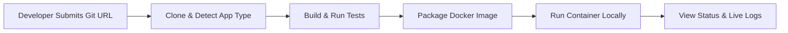

# microPass: Minimum Viable Product (MVP) Specification

## 1. Problem and Solution

### The Problem
Deploying applications locally or on self-hosted infrastructure typically requires manual, repetitive steps: configuring build environments, managing Docker commands, configuring ports and networks, and tailing log files. Existing PaaS platforms (like Heroku or cloud-managed solutions) often incur recurring costs, require vendor lock-in, or present steep operational complexity (e.g., full Kubernetes clusters) unsuitable for resource-constrained or single-machine environments.

### The Solution
**microPass** is a lightweight, zero-cost, self-hosted Application Deployment Platform (PaaS) designed for individual developers and small teams. It automates the workflow from source code to running container: cloning a Git repository, building and testing the code, packaging it into an isolated Docker container, routing traffic locally, and exposing real-time logs and deployment states through a clean web interface or API.

---

## 2. MVP User Journey

1. **Trigger:** The developer inputs a Git repository URL (and optional branch/commit) via the microPass UI or API.
2. **Fetch:** microPass clones the repository into a sandbox directory.
3. **Build & Test:** microPass executes the build and test pipeline (either via a local runtime container or an included `Dockerfile`).
4. **Package:** microPass builds a versioned Docker image for the target application.
5. **Deploy:** microPass spins up the container with assigned network and host port mappings, stopping any preceding container instance for that project.
6. **Observe:** The developer monitors real-time build and runtime logs and views health status (Running, Stopped, Failed) directly on the dashboard.

---

## 3. MVP Features

| Domain | Feature | Description |
| :--- | :--- | :--- |
| **Project Management** | App Registry | Register, list, inspect, and delete applications by name and Git URL. |
| **Pipeline Engine** | Build & Test Runner | Sequential pipeline execution: clone, build/test execution, exit code verification. |
| **Packaging** | Docker Builder | Build container images from repository `Dockerfile` (or standard templates). |
| **Deployment** | Local Container Lifecycle | Start, stop, restart, and inspect application containers via the local Docker engine. |
| **Port Management** | Basic Port Allocation | Dynamically or statically allocate host ports mapped to container ports to avoid collisions. |
| **Observability** | Log Streaming & Status | Stream build logs (stdout/stderr) during deployment and capture runtime container stdout/stderr. |
| **Interface** | Minimal Web Dashboard | Simple web UI to trigger deployments, view historical build status, and view logs. |

---

## 4. Out of Scope (Reserved for Future Phases)

The following capabilities are deliberately excluded from the MVP to keep scope tight and realistic for a single engineer:

* **Clustering & Orchestration:** No Kubernetes, Nomad, or Docker Swarm. Execution is strictly on a single local Docker daemon.
* **Cloud Infrastructure & Provisioning:** No Terraform, AWS/GCP/Azure API integration, or remote VPS bootstrapping.
* **Multi-Tenancy & RBAC:** Single-tenant only (no multi-organization workspaces, complex user permissions, or fine-grained team roles).
* **Advanced Networking & Ingress:** No automatic Let's Encrypt SSL/TLS certificate management, automatic DNS manipulation, or complex service meshes. (A lightweight reverse proxy like Traefik/Caddy may be introduced later).
* **Security Sandboxing of Untrusted Code:** No execution of untrusted public code via microVMs (e.g., Firecracker/gVisor). MVP assumes the developer runs their own trusted code.
* **Advanced Monitoring:** No distributed tracing, Prometheus metrics scrapers, or Grafana dashboards.

---

## 5. Proposed Technology Stack (Provisional)

All tools are free, open-source, and suited for a 16 GB RAM Arch Linux environment.

| Component | Proposed Technology | Rationale |
| :--- | :--- | :--- |
| **Backend & Engine** | **Java 21 + Spring Boot 3** | Leverages your primary technical strengths; robust ecosystem for process execution, async pipelines, and modular structure. |
| **Architecture** | **Modular Monolith** | Avoids the high operational and network overhead of microservices while maintaining clean boundary separations (Pipeline, Docker, Apps, Web). |
| **Container Engine** | **Docker Engine (Local Daemon)** | Universal standard, native to Arch Linux (`docker` package), zero-cost, simple integration via official Docker CLI / Docker Java API. |
| **Database** | **SQLite or PostgreSQL (Embedded/Local Container)** | PostgreSQL in Docker or embedded SQLite/H2 for tracking projects, deployments, build logs metadata, and state transitions with minimal memory footprint (~30–80 MB). |
| **Real-time Logs** | **Server-Sent Events (SSE) or WebSockets** | Native Spring Boot support (`SseEmitter` or Spring WebSocket) for unidirectional log streaming to the browser without heavy message brokers. |
| **Frontend UI** | **HTMX + Thymeleaf** (or lightweight React/Vue) | **HTMX + Tailwind/Thymeleaf** eliminates complex JS build chains and high Node.js memory footprints, keeping the entire app within the Spring monolith. |
| **Process Execution** | **Java `ProcessBuilder` / Docker Java Client** | Direct, deterministic control over Git and Docker execution with standard stream handling. |

> *Note: These selections are provisional proposals for review; no installations or code changes will take place until explicitly authorized.*

---

## 6. Milestones

### Phase 1: Prototype & Core Execution Loop
* **M1.1: Project Skeleton & Domain Model:** Modular Spring Boot project structure with base entities (`Application`, `Deployment`, `BuildLog`).
* **M1.2: Git & Build Process Runner:** Implement sandboxed workspace cloning and local build command execution with stdout/stderr capture.
* **M1.3: Docker Packaging & Local Run:** Integrate Docker CLI / SDK to build an image from a sample repository and start a container on an assigned port.

### Phase 2: Pipeline Coordination & Status Tracking
* **M2.1: Deployment Orchestrator:** State machine coordinating transitions (`QUEUED` $\to$ `BUILDING` $\to$ `DEPLOYING` $\to$ `HEALTHY` / `FAILED`).
* **M2.2: Log Streaming:** Stream build output and container runtime logs via Server-Sent Events (SSE).
* **M2.3: Port Mapping & Container Cleanup:** Ensure re-deploying stops old containers cleanly and recycles host ports without conflicts.

### Phase 3: Developer Dashboard & Verification
* **M3.1: Minimal Web UI:** Dashboard to view applications, trigger manual builds, monitor progress indicators, and inspect historical runs.
* **M3.2: End-to-End MVP Verification:** Validate the pipeline using a reference Spring Boot / Node.js sample repository from clone to live local URL.

### Future Enhancements (Post-MVP)
* Automated Git Webhooks (GitHub/GitLab push-to-deploy).
* Automatic reverse proxy integration (Caddy or Traefik for domain-based local routing `http://myapp.local`).
* Environment variable and secret management (`.env` injection).
* Multi-container support (`docker-compose.yml`).
* Buildpack support (Paketo / Cloud Native Buildpacks) to eliminate mandatory `Dockerfile` requirements.

---

## 7. Acceptance Criteria

The MVP will be considered complete when the following measurable criteria are met:

1. **Repository Ingestion:** Successfully clones a public Git repository from GitHub/GitLab into a designated microPass data directory.
2. **Deterministic Build:** Runs build tests; if tests fail, halts the pipeline, marks the deployment as `FAILED`, and retains the error log.
3. **Image Creation:** Produces a tagged local Docker image upon successful build.
4. **Local Running Container:** Launches the container, binds it to an accessible `localhost:<port>`, and confirms HTTP reachability.
5. **Zero Downtime / Clean Replacement:** Triggering a redeployment replaces the existing container without port-binding clashes or orphaned containers.
6. **Log Visibility:** The user can inspect the complete build log and live stdout/stderr of the running application via the UI.
7. **Resource Footprint:** The idle microPass platform consumes less than 500 MB of RAM on the host machine.

---

## 8. Constraints and Risks

| Risk / Constraint | Impact | Mitigation Strategy for MVP |
| :--- | :--- | :--- |
| **Resource Limits (16 GB RAM)** | Large builds or memory-heavy containers can exhaust host memory. | Set Docker container memory caps (`--memory=512m`) during build and run steps. Limit concurrent builds to 1. |
| **Security of Untrusted Repositories** | Malicious build scripts (`pom.xml`, `package.json`, `Dockerfile`) could access host files or Docker socket. | Restrict MVP usage strictly to developer's own repositories. Isolate builds inside transient Docker containers rather than executing raw bash scripts directly on the host OS. |
| **Docker Socket Security** | Exposing `/var/run/docker.sock` to the app gives root-equivalent host access. | Keep microPass running as a standard host process or rootless Docker container where possible. |
| **Scope Creep** | Adding features like distributed nodes, Traefik, or multi-user auth early will derail completion. | Maintain strict adhesion to the Modular Monolith architecture; treat non-MVP items as distinct post-MVP phases. |

