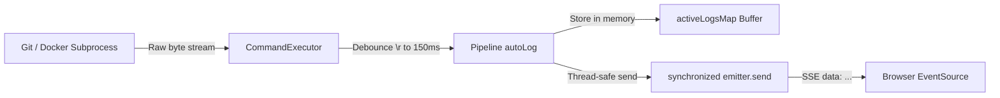

# Phase 3.5: Platform Hardening & Real-Time Engine Deep Dive

This phase bridges the foundational MVP into a resilient, production-grade application deployment engine. We addressed real-world concurrency, OS process orchestration, and streaming communication challenges.

---

h
## 1. Concurrency: Spring `@Async` Proxy Mechanics vs. Java 21 Virtual Threads

### The Problem: Spring AOP Self-Invocation Bypass
Initially, the pipeline method was annotated with `@Async`:

```java
// INSIDE DeploymentPipelineService.java
public Deployment triggerDeployment(Long appId) {
    ...
    runPipelineAsync(app.getId(), deployment.getId()); // <-- Direct method call!
    return deployment;
}

@Async
public void runPipelineAsync(Long appId, Long deploymentId) {
    // Git clone, Docker build, health checks...
}
```

### Why It Failed:
Spring's `@Async` relies on **Spring AOP Dynamic Proxies (CGLIB)**. When Bean A calls `@Async` on Bean B, Bean A actually calls a generated proxy wrapper. The proxy dispatches the call to an executor thread pool and immediately returns.

However, when a method calls another method **inside the same class** (`this.runPipelineAsync(...)`), the call is executed directly on the current Java instance (`this`), completely bypassing the Spring proxy!

```mermaid
graph TD
    subgraph Spring Proxy Architecture
        Caller[HTTP Request Thread] -->|Calls Bean| Proxy[Spring AOP Proxy]
        Proxy -->|Intercepts @Async| Pool[TaskExecutor / Thread Pool]
        Pool -->|Executes asynchronously| Target[Actual Service Bean]
    end

    subgraph Self-Invocation Bypass (The Bug)
        SelfCaller[triggerDeployment] -->|this.runPipelineAsync| TargetMethod[runPipelineAsync]
        Note[Bypasses Proxy! Executes synchronously on HTTP thread!]
    end
```

Because the proxy was bypassed, the entire Git clone and Docker build ran **synchronously on Tomcat's HTTP thread**. The browser was kept waiting for the POST response to finish before it could even begin listening for logs.

### The Solution: Native Java 21 Virtual Threads
Rather than relying on Spring AOP annotations, we dispatched directly to a Java 21 native Virtual Thread:

```java
final Long finalAppId = app.getId();
final Long finalDeploymentId = deployment.getId();

Thread.ofVirtual()
      .name("pipeline-" + finalDeploymentId)
      .start(() -> runPipeline(finalAppId, finalDeploymentId));

return deployment;
```

#### Why Virtual Threads Fit Here:
- **Zero Configuration:** No need for thread pool sizing or self-injection hacks (`@Lazy private DeploymentPipelineService self`).
- **Near-Zero Footprint:** Platform threads in Linux allocate $\approx 1\,\text{MB}$ of stack memory each. Virtual threads are lightweight user-mode objects managed by the JVM, allocating only hundreds of bytes.
- **Immediate Return:** `triggerDeployment` returns an HTTP 202 response to the browser in $< 5\,\text{ms}$, freeing Tomcat's thread immediately.

---

## 2. Server-Sent Events (SSE): High-Frequency Streams & Race Conditions

### The Dual Race Condition
When designing real-time log streaming over HTTP SSE, two issues emerge:

1. **The Late-Subscriber Race:** The virtual thread starts producing logs before the browser's HTTP `GET /logs/stream` request arrives. Without a buffer, early lines (like `git clone`) are broadcast to an empty subscriber set and lost.
2. **The Socket Flooding Race:** `git clone --progress` outputs carriage returns (`\r`) for every 1% increment (up to 100 times in 50ms). When calling `SseEmitter.send()` at this frequency, Tomcat's asynchronous response writer throws an `IllegalStateException` (`TEXT_PARTIAL_WRITING`), which causes Spring to drop the connection.

### The Engineering Solution:



#### A. In-Memory Ring Buffer (`LogStreamService`)
We introduced `activeLogsMap` to cache active logs during execution:

```java
// deploymentId -> List of accumulated active logs in memory
private final Map<Long, List<String>> activeLogsMap = new ConcurrentHashMap<>();

public void broadcast(Long deploymentId, String logLine) {
    if (logLine == null) return;
    activeLogsMap.computeIfAbsent(deploymentId, k -> new CopyOnWriteArrayList<>()).add(logLine);

    List<SseEmitter> emitters = emittersMap.get(deploymentId);
    if (emitters == null) return;

    for (SseEmitter emitter : emitters) {
        try {
            synchronized (emitter) {
                emitter.send(SseEmitter.event().data(logLine));
            }
        } catch (Exception e) {
            removeEmitter(deploymentId, emitter);
        }
    }
}
```

When a user subscribes (even seconds later, or upon refreshing the page):
1. `subscribe()` checks `activeLogsMap.get(deploymentId)`.
2. All buffered logs are replayed in order.
3. Live streaming seamlessly continues from that point forward.

#### B. Progress Debouncing in `CommandExecutor`
Instead of sending every raw `\r` tick, [`CommandExecutor.java`](file:///home/mohssine/Desktop/projects/microPass/src/main/java/com/micropass/common/CommandExecutor.java#L55-L68) debounces progress lines:

```java
if (c == '\n') {
    // Real newline: Always emit immediately
    emitLine(lineBuffer.toString());
} else if (c == '\r') {
    long now = System.currentTimeMillis();
    // Debounce progress ticks to at most once per 150ms, or on 100% completion
    if (now - lastCarriageReturnEmit > 150 || line.contains("100%") || line.contains("done")) {
        emitLine(lineBuffer.toString());
        lastCarriageReturnEmit = now;
    }
}
```

---

## 3. OS Process Tree Termination in Linux

### The Problem with `Process.destroyForcibly()`
When executing a shell command like `git clone` or `docker build`, the operating system creates a process hierarchy:

```
Process Hierarchy:
[Java JVM (PID 1000)]
   └── [sh / bash (PID 1050)]  <-- Targeted by process.destroyForcibly()
          └── [git (PID 1051)]
                 └── [git-remote-https (PID 1052)]  <-- Kept running as orphaned process!
                 └── [git index-pack (PID 1053)]    <-- Holding open workspace files!
```

Calling `process.destroyForcibly()` only sends `SIGKILL` to PID 1050. The child processes (PIDs 1052, 1053) are orphaned, adopted by `systemd` (PID 1), and continue running. They hold file locks and keep network sockets open.

### The Solution: Java 9+ `ProcessHandle` Tree Traversal
In [`CommandExecutor.killProcessTree`](file:///home/mohssine/Desktop/projects/microPass/src/main/java/com/micropass/common/CommandExecutor.java#L110-L118):

```java
public static void killProcessTree(Process process) {
    if (process == null) return;
    try {
        // Destroy all descendant processes first (bottom-up)
        process.descendants().forEach(ProcessHandle::destroyForcibly);
        process.destroyForcibly();
    } catch (Exception ignored) {
    }
}
```

By querying `process.descendants()`, Java uses Linux's `/proc` filesystem to find all children recursively and terminates every worker before killing the parent.

---

## 4. Database Resilience: Enums vs. `VARCHAR` and Startup Recovery

### A. The H2 Native Enum Pitfall
When using Hibernate with `spring.jpa.hibernate.ddl-auto=update`:
- Initially, `DeploymentStatus` had 7 states (`QUEUED`, `CLONING`, `BUILDING`, `DEPLOYING`, `HEALTHY`, `FAILED`, `STOPPED`).
- H2 created the column as a native database type:
  `status ENUM('BUILDING', 'CLONING', 'DEPLOYING', 'FAILED', 'HEALTHY', 'QUEUED', 'STOPPED')`
- When we added `CANCELLED` to the Java enum, Hibernate's `update` strategy **did not alter the existing H2 ENUM definition**.
- Saving `status = CANCELLED` triggered an immediate database exception:
  `JdbcSQLDataException: Value not permitted for column ...: "CANCELLED"`

#### The Engineering Fix:
Explicitly map state enums with a defined length as `VARCHAR`:

```java
@Enumerated(EnumType.STRING)
@Column(nullable = false, length = 32, columnDefinition = "varchar(32)")
private DeploymentStatus status;
```

In production database architectures, storing status enums as `VARCHAR(32)` avoids DDL table locks and migration failures when new lifecycle states are introduced.

### B. Zombie Deployment Recovery on Startup
If the server crashes or is killed while a build is running, the deployment remains persisted in the database as `CLONING` or `BUILDING`. When the server boots back up, that record would appear perpetually stuck.

We implemented an [`ApplicationReadyEvent`](file:///home/mohssine/Desktop/projects/microPass/src/main/java/com/micropass/service/DeploymentPipelineService.java#L57-L77) listener in `DeploymentPipelineService`:

```java
@EventListener(ApplicationReadyEvent.class)
public void recoverStaleDeployments() {
    List<DeploymentStatus> activeStatuses = List.of(
            DeploymentStatus.QUEUED,
            DeploymentStatus.CLONING,
            DeploymentStatus.BUILDING,
            DeploymentStatus.DEPLOYING
    );
    List<Deployment> stale = deploymentRepository.findByStatusIn(activeStatuses);
    for (Deployment d : stale) {
        d.setStatus(DeploymentStatus.CANCELLED);
        d.setFinishedAt(LocalDateTime.now());
        d.setBuildLogs((d.getBuildLogs() != null ? d.getBuildLogs() : "") 
            + "\n⚠️ [RECOVERY] System was restarted while deployment was active. Marked as CANCELLED.\n");
        deploymentRepository.save(d);
        workspaceService.cleanWorkspace(d.getApp().getId(), d.getId());
    }
}
```

Whenever the server restarts:
1. Any orphaned deployment is gracefully transitioned to `CANCELLED`.
2. Incomplete workspace folders are purged.
3. The dashboard displays `⊘ Cancelled` and enables the **Deploy Now** button immediately.

---

## 5. UI State Machine & DTO Isolation

### A. Preventing Hibernate Jackson Lazy-Loading Exceptions
When entities have JPA relationships (like `Deployment` $\to$ `App`), serializing the entity directly in a Spring controller can trigger lazy-loading exceptions or infinite recursion.

We introduced [`DeploymentResponse.java`](file:///home/mohssine/Desktop/projects/microPass/src/main/java/com/micropass/web/DeploymentResponse.java), a clean Java `record` acting as a Data Transfer Object (DTO):

```java
public record DeploymentResponse(
    Long id,
    Long appId,
    String appName,
    DeploymentStatus status,
    String commitHash,
    String imageTag,
    String containerId,
    Integer port,
    LocalDateTime startedAt,
    LocalDateTime finishedAt
) {}
```

### B. Bi-Directional Button State Machine
In [`dashboard.html`](file:///home/mohssine/Desktop/projects/microPass/src/main/resources/templates/dashboard.html#L330-L470), the console buttons adapt dynamically based on lifecycle events:

```
[Trigger / Monitor Build]
   │
   ├─► Cancel Button: Visible (Red)
   └─► Close Button:  "Close Console (Keeps running)"
   
[Cancel Clicked OR Build Completes (SUCCESS / FAILED)]
   │
   ├─► Cancel Button: Hidden
   └─► Close Button:  "Close Console"  <-- "(Keeps running)" removed
```

---

## Summary of Core Concepts Mastered

| Concept | What It Solves | Key Implementation |
| :--- | :--- | :--- |
| **Java 21 Virtual Threads** | Prevents blocking HTTP request threads during long operations without Spring proxy self-invocation traps | `Thread.ofVirtual().name(...).start(...)` |
| **Linux Process Trees** | Ensures child processes (`git-remote-https`, `pack-objects`) do not orphan when aborted | `process.descendants().forEach(ProcessHandle::destroyForcibly)` |
| **In-Memory SSE Replay** | Solves late-subscriber race conditions where logs are emitted before browser connects | `activeLogsMap.computeIfAbsent(...)` |
| **Progress Debouncing** | Prevents Tomcat `IllegalStateException` socket drops from rapid `\r` carriage returns | 150ms time-window gating in `CommandExecutor` |
| **DTO Projections** | Decouples JPA database entity state from JSON serialization | `DeploymentResponse` Java record |
| **Startup Event Listeners** | Cleans up zombie database records after sudden platform restarts | `@EventListener(ApplicationReadyEvent.class)` |
